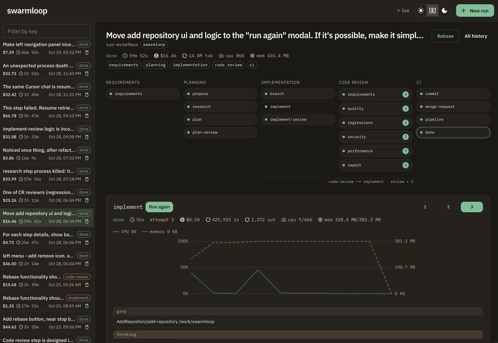
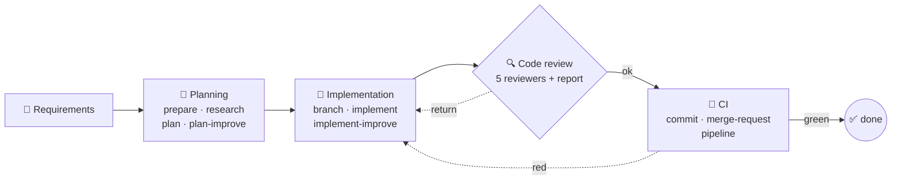

<div align="center">

<br>


# swarmloop

[](https://github.com/swarmloop/swarmloop/actions/workflows/ci.yml)

**Coding agents that have to pass five reviewers and your CI before they reach you. A sandbox around every step, a record of every dollar.**

<p>
  <a href="LICENSE"></a>
  
  
  
</p>

[Quick start](#-quick-start) · [CI](#-commit-merge-request-and-ci) · [Features](#-features) · [JetBrains](#-jetbrains) · [Settings](#-settings)

</div>

swarmloop takes a ticket or a prompt and walks a coding agent through requirements, research, a plan, and implementation. Then the work has to earn your attention. Five reviewers read the diff in parallel, and any finding sends it back to the agent. Only when they agree does the server commit, push a branch, open a merge request, and watch your pipeline. A red job sends the work back too. You open the merge request when the reviewers and every check in your pipeline have passed.

Every step runs in a locked container. Every prompt, diff, review, token, and dollar is stored. Cursor, Claude, or Codex is one line in `.env`.



| Feature | What you get |
| --- | --- |
| 🔒 **Sandbox** | The only way out is a proxy that lets each step reach its own hosts. Claude and Codex API keys never enter the container. Read-only root, no capabilities, no Docker socket. Git and Jira tokens stay out. |
| 🧵 **Parallel runs** | Several tasks at once, even in one repository. Each run has its own worktree and branch. Your working copy is not touched. |
| 🗂 **One history** | Prompt, plan, diff, reviews, model exchanges, tokens, dollars, CPU, and memory in one SQLite file. |
| 🔀 **Cursor, Claude, or Codex** | One line in `.env`. Research, plan, and implementation each pick their own model. |
| 🎫 **Jira, Confluence, Drive** | The ticket, its epic, links, subtasks, attachments, and the pages around it. |
| 🌿 **GitHub and GitLab** | Feature branch, commit once the reviewers pass, merge request, pipeline watch. |
| 🔍 **Five reviewers** | Requirements, quality, regressions, security, performance. A finding sends the work back. |
| 🔄 **Rebase** | One button rebases onto the latest base branch, hands conflicts to the agent, and reviews again. The same rebase runs by itself when the host reports a merge conflict on the merge request. |
| 💰 **Limits** | Dollars, tokens, time, silence, and retries are server settings, not the agent's choice. |
| 🖥 **Live panel, CLI, IDE** | The panel updates as each step runs. The CLI and JetBrains AI Chat start the same runs, with the same steps, rules, and history. |
| 📊 **Statistics** | Spend, tokens, and CPU and memory charts for every step, plus every external HTTP call. |
| 👥 **Team server** | One machine, one flow, shared rules in `skills/`, one bill. |

## 🚀 Quick start

You need Docker and one model key. No Jira, no git token, no CI.

1. Download `compose.yml` and the settings of the latest release into an empty directory:

   ```sh
   curl -fsSLO https://github.com/swarmloop/swarmloop/releases/latest/download/compose.yml
   curl -fsSL https://github.com/swarmloop/swarmloop/releases/latest/download/env.example -o .env
   ```

   `CHECKOUTS_ROOT` in `.env` is the folder with your git clones (default: the parent of this directory).

2. In `.env`, set `CURSOR_API_KEY` from the [Cursor dashboard](https://cursor.com/dashboard), **API Keys**. That key uses your Cursor plan, so there is no separate API bill. For Claude, set `RUNTIME=claude` and either `CLAUDE_CODE_OAUTH_TOKEN` from `claude setup-token` to use your Claude subscription, or `ANTHROPIC_API_KEY` from [Claude Console](https://platform.claude.com/settings/keys). A subscription token is for your own use on your own server, not one plan shared by a team. Leave every other secret empty.

   For Codex:

   - `RUNTIME=codex`.
   - Subscription (ChatGPT Plus or Pro, no API bill): on your own machine run `codex login`. On a server without a browser run `codex login --device-auth`. Then put the file in `.env` as one line: `CODEX_AUTH=$(base64 -w0 ~/.codex/auth.json)` (macOS: `base64 -i ~/.codex/auth.json | tr -d '\n'`), pasted as the value, not as a command. The file is a password: never commit it, never share it. It is for your own use on your own server, not one plan shared by a team. Use this login only for swarmloop: a ChatGPT login can be refreshed from one place at a time, so also running `codex` with it on your laptop would log the server out. On a team server, log in once on that server.
   - API key instead: `CODEX_API_KEY` from the [OpenAI platform dashboard](https://platform.openai.com/api-keys) (API keys); it is billed per token. If both are set, `CODEX_AUTH` wins.
   - The server keeps the login in `data/codex/` (it survives restarts) and refreshes it itself every few days, so parallel reviewers and steps never fight over it. `CODEX_AUTH` in `.env` is only the starting point: it is used again only when you change its value. Nothing to do by hand, unless the log says `Codex login expired`: then run `codex login`, paste the new value into `CODEX_AUTH` and restart the server.
   - **Subscriptions and automated use.** A subscription (Claude, ChatGPT or Cursor plan) has usage windows, and swarmloop stops using a runtime for the rest of a window when its CLI reports the limit (see `LIMIT_COOLDOWN_MIN`). Whether a plan may drive a CLI unattended is the provider's rule, not swarmloop's: read [Anthropic's consumer and commercial terms](https://www.anthropic.com/legal), [OpenAI's terms of use](https://openai.com/policies/terms-of-use/) and [Cursor's terms of service](https://cursor.com/terms-of-service) before you run a subscription login unattended. The API-key settings (`ANTHROPIC_API_KEY`, `CODEX_API_KEY`) are the metered, automation-friendly path. This note was written without opening those pages, so check the current wording yourself.
   - A quick check: start a run with `RUNTIME=codex`; the first step answers if the login works.

3. Start it. The release images are pulled, nothing is built here:

   ```sh
   docker compose up -d --wait
   ```

4. Open [http://127.0.0.1:3921](http://127.0.0.1:3921). The start page shows what a run needs: Docker, images, disk, paths, ports, and your keys. **New run** stays off while an item says `fail`, and the item says what to do. `docker compose exec server node dist/main.js doctor` prints the same list. Then click **New run**, pick a repository, untick **ci**, and describe the change. Leave ticket numbers out.

The repository list is every git clone in `CHECKOUTS_ROOT`, the folder you set in `.env`. The agent edits its own worktree, not your working copy. Nothing is pushed, and Jira is not called.

**Update:** `docker compose pull && docker compose up -d`. To stay on one release, set `SWARMLOOP_VERSION` in `.env`, for example `0.2.0`. Before it migrates the database, the server copies it to `data/backups/` (the last 3 are kept). An older version refuses a database a newer one migrated and names the backup. To go back: `docker compose down`, copy that backup over `data/swarmloop.sqlite`, delete `data/swarmloop.sqlite-wal` and `-shm`, copy the session files from its `.sessions` folder into `data/`, set the older `SWARMLOOP_VERSION` and `docker compose up -d`.

### 🚢 Commit, merge request, and CI

Add a git token to `.env` and run `docker compose up -d` again. This time leave **ci** ticked. When the reviewers pass, the server pushes a feature branch, opens a merge request, and watches the pipeline. Nobody has to click in between.

- GitHub needs `GITHUB_TOKEN`. GitLab needs `GITLAB_TOKEN`, and `GITLAB_BASE_URL` when it is self-hosted. Both may be set. The server picks the host whose hostname equals the checkout `origin`.
- The same token is also used to fetch the base branch, and a run on an SSH origin stops at prepare without it.
- The server commits as the clone's own `user.email`. If the clone has none, set `GIT_AUTHOR_NAME` and `GIT_AUTHOR_EMAIL`.

<details>
<summary><strong>GitLab token</strong></summary>

`GITLAB_BASE_URL` is `https://gitlab.com` when the remotes are on gitlab.com. Create `GITLAB_TOKEN` from [Personal access tokens](https://gitlab.com/-/user_settings/personal_access_tokens): **Generate token** → **Fine-grained token**, scoped to the group that owns the repositories. Grant only these permissions:

| Resource | Permission |
| --- | --- |
| Code | Download, Push |
| Pipeline | Read |
| Job | Read |
| Merge request | Read, Create, Update |

**Code: Download** is the git read. Rebase fetches the remote source branch with this token. Without Download, GitLab refuses the fetch: `This operation requires a fine-grained personal access token with the following project permissions: [Code: Download].` **Code: Push** is the git write the server uses once the reviewers pass. Your role on each project still has to be at least Developer.

</details>

<details>
<summary><strong>GitHub token</strong></summary>

`GITHUB_BASE_URL` is `https://github.com` when the remotes are on github.com. Create `GITHUB_TOKEN` from [Fine-grained personal access tokens](https://github.com/settings/personal-access-tokens): **Generate new token**. Resource owner is the account or organization that owns the repositories. Repository access is only the repositories this run pushes. Grant only these permissions:

| Resource | Permission |
| --- | --- |
| Contents | Read and write |
| Pull requests | Read and write |
| Actions | Read |
| Workflows | Read and write |
| Metadata | Read |

**Contents: Read and write** is the git read and the git write. Rebase fetches the remote source branch with this token, and that fetch uses the read half. The write half is what the server uses once the reviewers pass. Your account still has to be able to push to each repository. **Workflows: Read and write** is required when a commit creates or changes a file under `.github/workflows`. Without it GitHub rejects the push: `refusing to allow a Personal Access Token to create or update workflow ... without workflow scope`. GitHub shows the token once.

</details>

### 🧪 Project environment

Without any file the agent works as before: it writes code and CI is the judge. Describe the project's environment, and the implementation agent works inside it, with your toolchain, and checks its own work before the reviewers see it.

Give one of these, swarmloop reads the first it finds on the committed branch:

1. `.swarmloop.json` in the repository root:

   ```json
   {
     "version": 1,
     "image": "node:22-bookworm-slim",
     "setup": "npm ci",
     "checks": ["npm run lint", "npm test"],
     "cache": ["/home/sandbox/.npm"]
   }
   ```

   | Key | Meaning |
   | --- | --- |
   | `image` | The image to work in. Give this or `dockerfile`, not both. |
   | `dockerfile` | A file under `.swarmloop/` that builds the image, with `.swarmloop/` as its build context. |
   | `setup` | One command that installs dependencies. Optional. |
   | `checks` | Commands the agent must run and see pass before it finishes. Optional. |
   | `cache` | Absolute paths below `/home/sandbox/` that survive between runs, such as a package-manager cache. |
   | `network` | `registries` (default): the agent may install and upgrade packages itself. `setup`: only the setup reaches the registries, and the agent gets the model API alone. Choose `setup` when dependencies should change only by hand. Optional. |

2. `.devcontainer/devcontainer.json`, if the project already has one: `image`, or `build.dockerfile` with `build.context`, and `onCreateCommand`, `updateContentCommand` and `postCreateCommand` as the setup. Add the checks as `"customizations": { "swarmloop": { "checks": ["npm test"] } }`, and `"network": "setup"` there too if you want it. `features` and Docker Compose are not supported yet: put those tools in the Dockerfile.

How it runs:

- The image is pulled once, or built from the committed Dockerfile and reused until a file in its build context changes.
- The image must be Debian or Ubuntu based and have `bash`, because the Claude and Cursor CLIs need glibc. `scripts/agent-env-probe.sh <image>` tells you whether it works. If it does not, the step stops and says so.
- `setup` runs before implementation, in the project image, with the package registries and no model key. Successful setup is reused. A failure stops the step with its exit code and last lines; Resume retries setup.
- `implement` and `implement-improve` run in the image, with the agent CLI mounted read-only from its own image. Everything else of the sandbox stays: no root, no capabilities, read-only system, no Docker, the network only through the egress proxy, for the model and the package registries, no secret but the model key. The agent may run any command in its worktree: tests, lint, type checks, and the package manager, so it can add or upgrade a dependency. The lockfile it writes is committed with the code.
- The agent runs `checks` while working. Before `implement`, `implement-improve`, or rebase resolution can finish, the server independently runs every declared check in each repository's project image, without network or model credentials. The first failure stops the step and records feedback for Resume. Checks must be executable shell commands, without placeholders. Without declared checks there is no local completion gate; CI remains the final judge.
- Planning and read-only review limits belong to those stages; they are not implementation requirements. Implementation and Resume receive the current environment's execution rules. Without a project environment, the agent keeps the local test restriction. Explicit task restrictions are preserved, and conflicts with required checks must be reported.
- Project containers receive a temporary, read-only copy of Git metadata, so tools can read tracked files and diffs even in linked worktrees. The original Git state, credentials and host configuration are not mounted.
- The reviewers and CI come after it, as before. CI stays the final judge.
- The environment is frozen during a run. When an explicit Rebase changes the base commit, it refreshes the environment from that commit, including its Dockerfile, and reruns setup. Uncommitted or feature-branch manifest edits do not replace these trusted checks.
- Keep it the same as CI: the same image or version, and one command, such as `npm run check`, that both CI and `checks` call.

CI configuration is committed like other project files when the task requires it; explicit deny paths still apply. CI can execute changed workflows and scripts on push or PR/MR creation, before human review. Keep privileged secrets and deployment credentials behind protected branches/environments and required approvals; restrict job-token permissions and isolate runners used for unreviewed code. Human review before merge does not by itself protect earlier CI execution. The legacy `ALLOW_CI_CHANGES` setting is no longer used.

### 🎫 Jira (optional)

Only for prompts that name a ticket. A prompt without one never calls Jira.

- `JIRA_BASE_URL` is your site, such as `https://your-team.atlassian.net`.
- `JIRA_EMAIL` is the email you sign in to Atlassian with.
- `JIRA_API_TOKEN` comes from [Atlassian API tokens](https://id.atlassian.com/manage-profile/security/api-tokens): **Create API token**.
- `JIRA_PROJECTS` is a comma-separated list of project keys, such as `PROJ,OPS`. Only keys of these projects count as tickets in a prompt. Empty means every project that exists on the site.

Run `docker compose up -d` again after saving.

## ✨ Features

### 🔒 Sandbox and security

Every model step runs in a fresh container. The server starts it for the step and removes it when the step ends.

- **Disk.** Only this run's worktrees are mounted. Reviewers get them read-only. Home, `~/.ssh`, and other repositories are not there. A `.env` file inside a worktree is covered by an empty file.
- **Parallel.** Each run gets its own worktree of every repository in `worktrees/<run>/` and its own `feature/<run>-…` branch, so several runs, even in one repository, go at once. A run locks only itself, and `MAX_RUN_USD` counts each run separately.
- **Network.** A step that names no hosts runs with `--network none`. Every other step runs on `swarmloop-sandbox`, an internal Docker network with no route out. Its only exit is the `swarmloop-egress` proxy container, which the server starts by itself. Before a container starts, the server writes a policy for that container's address: which hosts it may reach. The proxy refuses everything else. It lets a model step reach only its vendor's API. Implementation and setup may also reach package registries: npm, Yarn, PyPI, Go, RubyGems, crates.io, Packagist, Maven, and Gradle. The setup also reaches GitHub release downloads and `nodejs.org`, where packages with native code (better-sqlite3, esbuild, sharp) fetch their prebuilt binaries; the agent does not, because `github.com` also takes pushes. With `"network": "setup"` in `.swarmloop.json` only the setup reaches the registries. Only HTTPS on port 443 passes, plus plain HTTP to those same hosts. The container gets `HTTPS_PROXY`, `HTTP_PROXY`, `NO_PROXY`, `NODE_USE_ENV_PROXY` and `JAVA_TOOL_OPTIONS`, so npm, pip, Go, Composer, cargo, Node and Gradle go through the proxy. Maven ignores these: give it a `<proxy>` for `198.18.0.2:3128` in `settings.xml`. A tool that ignores them is not let out at all, because there is no other route. DNS inside the sandbox answers nothing (`--dns 198.18.0.2`, where nothing listens on port 53): the proxy resolves names, so DNS can't carry data out either. A refused request is logged: `docker logs swarmloop-egress` shows the address and host. If a project needs another host, set `SANDBOX_EGRESS=open` for a while to check. That brings back the old per-host networks, which don't filter by host.
- **Model key.** Claude (API key or `CLAUDE_CODE_OAUTH_TOKEN`) and Codex with `CODEX_API_KEY` get a placeholder key, and their API address points at the proxy. The proxy replaces the placeholder with the real key, so the agent cannot print it, send it anywhere, or leave it in a file. A Cursor key and a Codex ChatGPT login (`CODEX_AUTH`) can't be replaced this way, so those stay in the container, but they can only reach their own vendor.
- **What the proxy can't stop.** The proxy only sees host names, not what is sent to them. An agent that wants to leak code could publish it to a package registry under an account of its own. `"network": "setup"` closes that for the agent, though the setup can still reach the registries. Keep secrets out of the worktree: the empty `.env` mask below covers only `.env` files.
- **Process.** Never root: a launch as root is refused. All Linux capabilities are dropped, `no-new-privileges` is set, the root filesystem is read-only, and the container gets at most 256 processes. There is no Docker socket, so it cannot start another container. The sandboxes share the host kernel: with gVisor installed on the Docker host, `SANDBOX_DOCKER_RUNTIME=runsc` gives each one a kernel of its own, so a kernel bug does not reach the host.
- **Secrets.** Jira, GitLab, and GitHub tokens stay in the server process. The model key is covered above.
- **Lifetime.** The step time limit, silence longer than `IDLE_TIMEOUT_MS`, or a token ceiling kills the container. It never outlives its step.
- **Git.** The agent does not commit and does not push. The server does, after the reviewers pass, and only for paths outside `deny_paths`.

### 🗂 One history, nothing lost

`data/swarmloop.sqlite` is the record of every run. It keeps the prompt, each document a step wrote, each model request and response, each loop back to implementation, and each call to Jira or the git host. An identical document is stored once.

**All history** on a run opens all of it: documents, prompts and responses, tokens by model, CPU and memory, loops, and HTTP calls. A step that crashed can resume the same agent chat. Anyone who can open the panel can open any run and see how the task was done.

### 🔀 Cursor, Claude, or Codex

- `RUNTIME=cursor`, `RUNTIME=claude`, or `RUNTIME=codex`. Change the line and restart the server: the next step uses that agent and opens a new chat with the full brief.
- Each role can use its own agent, a `runtime:model` pair: `AGENTS_PLAN`, `AGENTS_IMPLEMENT`, and `AGENTS_REVIEW`. `MODEL_PLAN` and `MODEL_IMPLEMENT` with `RUNTIME` stay as the short form. A step whose agent runs on another runtime than its stored chat opens a new chat with the full brief.
- Dollars come from the vendor's published price list, cached for a day.
- Another agent is the same three pieces: a sandbox image under `docker/sandbox`, its API hosts and key, and the code that reads its output. The pipeline, the history, and the panel stay as they are.
- For contributors building from a checkout, `docker/sandbox/build.sh` builds the three agent images and the `swarmloop-egress` proxy image (`compose.build.yml` builds them too). Run it again after you update swarmloop. Docker reuses its cache, so to get newer CLIs and certificates run `docker/sandbox/build.sh --fresh`, every few months is enough. Each image keeps its whole CLI under `/opt/swarmloop`, together with a CA certificate bundle (the public root list of Debian's `ca-certificates` package) and, for Codex, `rg`. swarmloop can therefore mount the CLI into another image.
- `scripts/agent-env-probe.sh <image>...` shows whether each CLI starts in a given image, for example `scripts/agent-env-probe.sh node:22-bookworm-slim php:8.3-cli`. Claude and Cursor need a glibc image with `bash`, so Debian or Ubuntu based. Alpine images do not work for them. Codex is one static binary and starts anywhere.

### 🎫 Jira, Confluence, and Google Drive

Put a Jira key in the prompt, or use it as the run id. swarmloop pulls the description, acceptance criteria, comments, attachments, the epic, linked issues, and one level of subtasks. Confluence pages on the same site, and Google Drive documents, sheets, slides, and files, are copied into the requirements record. The agent gets a brief of that record, not raw JSON.

A prompt without a ticket number never calls Jira. Jira is the tracker that ships. Another tracker implements the same `IssueTracker` interface in `server/src/integrations/issue-tracker`.

### 🌿 GitHub and GitLab

- One run can span several repositories. Research decides which ones get a feature branch.
- The server matches each checkout's `origin` with `GITHUB_BASE_URL` or `GITLAB_BASE_URL`. Point `GITLAB_BASE_URL` at a self-hosted GitLab and it works the same way.
- With **ci** ticked, the server commits by itself once the reviewers pass. It commits only paths outside `deny_paths` and refuses `main` and `master`. With **ci** unticked, the run stops at commit and shows the file list, and nothing is committed or pushed.
- A pull request or merge request is opened, or the existing one is updated.
- The server watches the pipeline on that branch. A red job's log goes back to implementation.
- A checkout with no `origin` still gets the full review. CI is skipped, and the panel says why.

### 📐 One flow, shared rules



The panel shows the same five phases. **New run** lets you switch phases off. Requirements always runs.

A person is asked where it matters:

- Research and plan stop on open questions until someone answers in the panel.
- Plan improve checks that the checklist covers everything the task asks for.
- With **ci** unticked, commit waits for you and shows the file list.

With **ci** ticked there is no click between the plan and the merge request. Your time comes last: you open it when the reviewers and your pipeline are green.

The instructions for every step are Markdown files in `skills/`. Edit one, rebuild the server, and every run after that follows it, for everyone on the server. The rules live in the repo and get reviewed like code. They are not a setting in someone's IDE.

### 🔍 Five reviewers, and they can say no

Requirements, quality, regressions, security, and performance review the diff at the same time, on a read-only mount. A report sums them up. Each reviewer ends with `decision: ok` or `decision: return`. A return sends the run back to implementation with the finding. A red pipeline does the same, on its own counter. `.env.example` allows 10 review returns and 6 pipeline returns.

A diff that was already reviewed is not returned a second time.

Before code review, implement improve reads the change again on the same model and fixes what it finds.

Passing review and CI is a minimum bar, not proof that the change is right. The reviewers run on the same family of models as the author, and green tests only show what the tests cover. You still read the diff. You just read one that already passed its own checks.

### 🔄 Rebase in one click

**Rebase** works on a run that is done, failed, or waiting. The branch is squashed to one commit on the fresh base and force-pushed with lease, and a conflict goes to implement once.

1. The server fetches the base branch from the remote (`main`, `master`, or the one the prompt names) and rebases every feature worktree onto it.
2. Edits that may ship are committed first. A denied path such as `.env` stays out. If it blocks the rebase, the rebase stops and says so.
3. A conflict goes back to the agent, which resolves it. Code review then runs on the new diff.
4. A clean rebase of a finished run reruns code review and CI on the new base and keeps the existing merge request.
5. A failed or waiting run continues from its step. A run whose checklist was not finished goes back to implementation.

When CI does not start and GitHub or GitLab confirms a merge conflict for the published SHA, Swarmloop automatically invokes the same Rebase action as the button, with the same repositories, base selection and continuation. Automatic invocation requires unchanged, clean worktrees, is attempted once per source SHA, and counts toward `MAX_PIPELINE_RETURNS`. Ordinary CI failures and unknown mergeability do not trigger it.

### 💰 Limits on money, tokens, and time

| Setting | What it limits | `.env.example` |
| --- | --- | --- |
| `MAX_RUN_USD` | Dollars per run. Once reached, the next step does not start. | `100` |
| `RETAIN_DONE_DAYS` | Days a done run keeps worktrees, agent state and outputs. `0` keeps all. | `3` |
| `MIN_FREE_GB` | Free disk below which old runs are cleaned and then steps are blocked (`DISK_LOW`). | `10` |
| `DOCKER_PRUNE` | Daily removal of dangling images and build cache older than 24 h. | `true` |
| `MAX_RUN_TOKENS` | Tokens per run. Kills the step. | off |
| `STEP_TOKEN_MAX` | Tokens per step. Kills the step. | off |
| `MAX_AGENT_CALLS` | Model processes per run | `100` |
| `MAX_RETURNS` | Review returns to implementation | `10` |
| `MAX_PIPELINE_RETURNS` | Red pipelines sent back | `6` |
| `MAX_LAUNCHES` | Relaunches of a step that crashed before it decided | `3` |
| `LIMIT_COOLDOWN_MIN` | Minutes a runtime stays out of use after a provider usage limit whose text names no reset time | `60` |
| `STOP_GRACE_S` | Seconds a container gets to stop on Stop before it is killed | `10` |
| `RECONCILE_MS` | How often the server looks for runs whose owner died | `60000` |
| `RECOVER_WAIT_MS` | How long a run waits for a container left by a dead server to exit before it is killed | `600000` |
| `IDLE_TIMEOUT_MS` | Silence before the agent is killed | 15 minutes |
| `LOOP_REPEAT` | The same failing command this many times in a row gets one hint; that many more end the step | `4` |
| `SANDBOX_EGRESS` | `proxy`: all traffic goes through the egress proxy. `open`: per-host networks without the proxy, for debugging only. | `proxy` |
| `SANDBOX_DOCKER_RUNTIME` | Docker runtime of the sandboxes, such as `runsc` for gVisor | Docker's default |
| `*_TIMEOUT_MS` | Wall time per step | 3 to 30 minutes |

### 📊 Statistics for every step

- Each step visit stores the model, duration, input and output tokens, dollars, and CPU and memory as an average and a peak.
- CPU and memory are sampled every 5 seconds and drawn as a chart under the step.
- **All history** totals tokens by model and lists every call to Jira and the git host: method, URL without credentials, status, and duration. The `Authorization` header is never stored.
- The run header shows the running totals. The sidebar shows the cost and duration of every run.

### 🖥 Panel, CLI, and IDE

- **Panel** at [http://127.0.0.1:3921](http://127.0.0.1:3921). A live board over a websocket, a filter by key, and light, dark, and system themes.
- **CLI.** `bin/swarmloop run KEY --prompt "…"`, `bin/swarmloop step NAME KEY`, and `bin/swarmloop fetch PROJ-123`. Review any local folder with `bin/swarmloop step code-review KEY --path /absolute/dir`. The CLI runs the same pipeline in its own process and writes the same history. The panel shows a CLI run after a reload, not live.
- **IDE.** `bin/sloop` speaks ACP, so an ACP client such as JetBrains AI Chat can start and continue runs. It goes through the API, so the panel follows those runs live. [Set up JetBrains](#-jetbrains).

**Run again** replays a step, and you choose which later phases run. A replay never moves a run that is further ahead back. The same dialog adds another repository to an open run. Removing a run deletes its rows, its worktrees, and its files.

`KEY` is a Jira key (`PROJ-123`) or a slug (`vendor-api`).

The CLI on the host needs a build:

```sh
npm ci --prefix server
npm run build --prefix server
bin/swarmloop run PROJ-123 --prompt "what this ticket is"
```

## 🧩 JetBrains

⛵ **`sloop` — not slop.**

JetBrains IDEs do not have a swarmloop plugin. From 2025.3 on, AI Assistant starts `bin/sloop` as a custom ACP agent and talks to it in AI Chat. The chat then reads and writes the same runs as the CLI. An older version shows only the built-in models in that chat, and **Add Custom Agent** is not in the menu.

The swarmloop API has to be up on `127.0.0.1:3920`. Started from source (`compose.build.yml`), `docker compose up` also copies the built client to `server/dist`, which is what `bin/sloop` runs. The IDE does not need a separate `npm run build`.

Then, in the IDE:

1. Install the **AI Assistant** plugin if it is not already there: **Settings | Plugins**, search for AI Assistant.
2. Open the **AI Chat** tool window.
3. Open **About**. The version has to be 2025.3 or newer. In an older IDE the `⋮` menu of AI Chat has Rename Chat, Settings, and Show Toolbar, and no way to add an agent. Update the IDE first.
4. Leave the model list at the bottom alone. That list is Gemini, GPT, LM Studio, and Ollama. In the top-right of AI Chat, next to the clock icon, open the `⋮` menu and choose **Add Custom Agent**.
5. The IDE creates `~/.jetbrains/acp.json` and opens it. Replace the contents with this, using the absolute path of `bin/sloop` on your machine:

```json
{
  "default_mcp_settings": {
    "use_custom_mcp": true,
    "use_idea_mcp": true
  },
  "agent_servers": {
    "sloop": {
      "command": "/Users/you/www/swarmloop/bin/sloop",
      "args": ["acp"],
      "env": {}
    }
  }
}
```

6. Save the file. **sloop** appears in the agent list at the top of AI Chat. Select it.
7. Type a prompt and send it. A prompt with no open run starts one. The next prompt continues that run.

On 2025.3 or newer, if **sloop** does not show up, restart the IDE. The same block is in `acp.json` at the repo root. Writing that file on an older IDE does nothing: the chat never reads it.

Open a chat whose session id is the run key, such as `PROJ-123`, and the stored history loads. `/review <path>` starts a code review of that checkout. `/step <name>` runs that step. `/replay` followed by a prompt starts the run again from requirements.

When the API is on another machine, set the URL in `env`:

```json
"env": { "SWARMLOOP_API_URL": "http://your-server:3920" }
```

`sloop` calls `http://127.0.0.1:3920` when that variable is empty. Any other ACP client starts the same command. The Cursor desktop app runs its own agent and does not load this file.

## 🔧 Settings

| Variable | Values |
| --- | --- |
| `RUNTIME` | `cursor`, `claude`, or `codex`. The runtime of the short form. The run stores the runtime of its first `implement` agent. |
| `MODEL_PLAN` | Short form: model of the `plan` and `review` roles on `RUNTIME`. `.env.example` uses `grok-4.7-xhigh`. |
| `MODEL_IMPLEMENT` | Short form: model of the `implement` role on `RUNTIME`. `.env.example` uses `grok-4.7-high`. |
| `AGENTS_PLAN` | Agents of the `plan` role (research, plan, plan improve, the merge request text), `runtime:model`, comma-separated. The first is used, the rest are the fallback order. Empty: `RUNTIME:MODEL_PLAN`. |
| `AGENTS_IMPLEMENT` | Agents of the `implement` role (implement, implement improve, rebase conflicts, chat and shell). Empty: `RUNTIME:MODEL_IMPLEMENT`. |
| `AGENTS_REVIEW` | Agents of the `review` role (every code reviewer and the review report). Empty: `RUNTIME:MODEL_PLAN`. |
| `AGENTS_SUBTASK_PLAN`, `AGENTS_SUBTASK_IMPLEMENT`, `AGENTS_SUBTASK_REVIEW` | The same for a run with a parent. Empty: the main role. |
| `ISSUE_TRACKER` | `jira` |
| `REQUIREMENTS_VIA` | `agent` or `direct`. Both build the requirements record in the server. The model does not rewrite it. |
| `CHECKOUTS_ROOT` | Folder of git clones listed in **New run**. |
| `TICK_MS` | How often a running pipeline is polled. `.env.example` uses `15000`. |
| `SWARMLOOP_API_HOST`, `SWARMLOOP_API_PORT` | Where the API listens. `.env.example` uses `127.0.0.1:3920`. |

Spend, tokens, retries, and timeouts are in [Limits](#-limits-on-money-tokens-and-time). A missing key stops bootstrap and names the variable. Copy `.env.example` and change what you want.

## 👥 For a team

Put it on one machine. Everyone who can open the panel sees the same runs, the same plans, and the same bill.

The flow is the same for every ticket. The rules live in `skills/` in this repo, so a change to a review or a plan rule reaches the whole team at the next server rebuild. Spend, tokens, and how many times a review may send work back are server settings, not a choice the agent makes.

There is no login. The network is the access control. The compose file publishes the panel and the API on `127.0.0.1`. On a shared machine that is the team. To reach them from other machines, publish the ports on an internal address. Do not put this on the public internet.

## 📜 License

swarmloop is licensed under the [Apache License 2.0](LICENSE).
