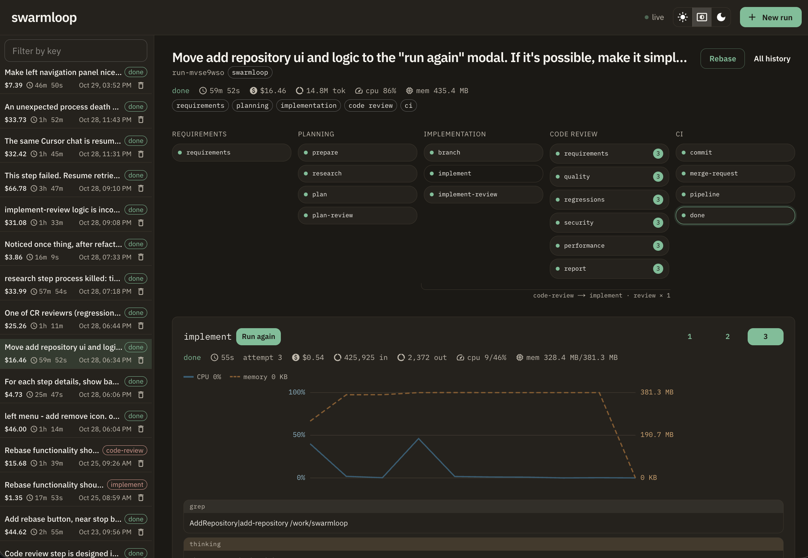
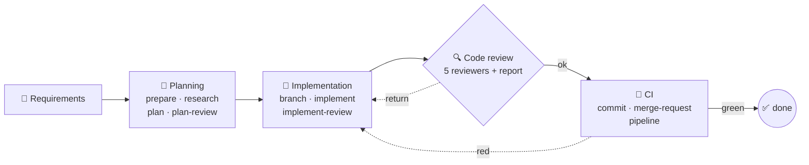

<div align="center">

# swarmloop

**One server for your coding agents. A fixed path from ticket to merge request, a sandbox around every step, and a record of every dollar.**

<p>
  <a href="LICENSE"></a>
  
  
  
</p>

[Quick start](#-quick-start) · [Features](#-features) · [Team install](#-team-install) · [PhpStorm](#-phpstorm) · [Settings](#-settings)

</div>

swarmloop takes a ticket or a prompt and walks a coding agent through requirements, research, a plan, implementation, five parallel code reviews, and CI. Every step runs in a locked container. Every prompt, diff, review, token, and dollar is stored. Cursor or Claude is one line in `.env`.



| Feature | What you get |
| --- | --- |
| 🔒 **Sandbox** | No network unless allowlisted, read-only root, no capabilities, no Docker socket. One model key inside. Git and Jira tokens stay out. |
| 🗂 **One history** | Prompt, plan, diff, reviews, model exchanges, tokens, dollars, CPU, and memory in one SQLite file. |
| 🔀 **Cursor or Claude** | One line in `.env`. Research, plan, and implementation each pick their own model. |
| 🎫 **Jira, Confluence, Drive** | The ticket, its epic, links, subtasks, attachments, and the pages around it. |
| 🌿 **GitHub and GitLab** | Feature branch, commit after you approve the files, merge request, pipeline watch. |
| 🔍 **Five reviewers** | Requirements, quality, regressions, security, performance. A finding sends the work back. |
| 🔄 **Rebase** | One button rebases onto the latest base branch, hands conflicts to the agent, and reviews again. |
| 💰 **Limits** | Dollars, tokens, time, silence, and retries are server settings, not the agent's choice. |
| 📊 **Statistics** | Spend, tokens, and CPU and memory charts for every step, plus every external HTTP call. |
| 👥 **Team server** | One machine, one flow, shared rules in `skills/`, one bill. |

## 🚀 Quick start

You need Docker and one model key. No Jira, no git token, no CI.

1. Copy the settings:

   ```sh
   cp .env.example .env
   ```

2. In `.env`, set `CURSOR_API_KEY`. For Claude, set `RUNTIME=claude` and `ANTHROPIC_API_KEY` instead. Leave every other secret empty.

3. Start it:

   ```sh
   docker compose up --build
   ```

4. Open [http://127.0.0.1:3921](http://127.0.0.1:3921), click **New run**, pick a repository, untick **ci**, and describe the change. Leave ticket numbers out.

The repository list is every git clone in `CHECKOUTS_ROOT`, which `.env.example` sets to the folder that holds swarmloop (`../`). The agent edits its own worktree, not your working copy. Nothing is pushed, and Jira is not called.

Ready for Jira and a git host? Go to [Team install](#-team-install).

## ✨ Features

### 🔒 Sandbox and security

Every model step runs in a fresh container. Nest starts it for the step and removes it when the step ends.

- **Disk.** Only this run's worktrees are mounted. Reviewers get them read-only. Home, `~/.ssh`, and other repositories are not there. A `.env` file inside a worktree is covered by an empty file.
- **Network.** `--network none` unless the step names hosts. A model step reaches only its vendor's API. Implementation may also reach package registries: npm, Yarn, PyPI, Go, RubyGems, crates.io, and Maven. Any other public host is refused before the container starts.
- **Process.** Never root: a launch as root is refused. All Linux capabilities are dropped, `no-new-privileges` is set, the root filesystem is read-only, and the container gets at most 256 processes. There is no Docker socket, so it cannot start another container.
- **Secrets.** The only secret passed in is the model key. Jira, GitLab, and GitHub tokens stay in the Nest process.
- **Lifetime.** The step time limit, silence longer than `IDLE_TIMEOUT_MS`, or a token ceiling kills the container. It never outlives its step.
- **Git.** The agent does not commit and does not push. Nest does, after you accept the file list.

### 🗂 One history, nothing lost

`data/swarmloop.sqlite` is the record of every run. It keeps the prompt, each document a step wrote, each model request and response, each loop back to implementation, and each call to Jira or the git host. An identical document is stored once.

**All history** on a run opens all of it: documents, prompts and responses, tokens by model, CPU and memory, loops, and HTTP calls. A step that crashed can resume the same agent chat. Anyone who can open the panel can open any run and see how the task was done.

### 🔀 Cursor, Claude, and what comes next

- `RUNTIME=cursor` or `RUNTIME=claude`. Change the line and restart Nest, and the next step uses the other agent. Both sandbox images ship in this repo.
- Each phase can use its own model: `MODEL_RESEARCH`, `MODEL_PLAN`, and `MODEL_IMPLEMENT`.
- Dollars come from the vendor's published price list, cached for a day.
- A third agent is code, not a setting: a sandbox image under `docker/sandbox`, its API hosts and key, and the code that reads its output. The pipeline, the history, and the panel stay as they are.

### 🎫 Jira, Confluence, and Google Drive

Put a Jira key in the prompt, or use it as the run id. swarmloop pulls the description, acceptance criteria, comments, attachments, the epic, linked issues, and one level of subtasks. Confluence pages on the same site, and Google Drive documents, sheets, slides, and files, are copied into the requirements record. The agent gets a brief of that record, not raw JSON.

A prompt without a ticket number never calls Jira. Jira is the tracker that ships. Another tracker implements the same `IssueTracker` interface in `nest/src/providers`.

### 🌿 GitHub and GitLab

- One run can span several repositories. Research decides which ones get a feature branch.
- Nest matches each checkout's `origin` with `GITHUB_BASE_URL` or `GITLAB_BASE_URL`. Point `GITLAB_BASE_URL` at a self-hosted GitLab and it works the same way.
- Commit stops and shows the file list. After you accept it, Nest commits only those paths, refuses `main` and `master`, and skips everything in `deny_paths`.
- A pull request or merge request is opened, or the existing one is updated.
- Nest watches the pipeline on that branch. A red job's log goes back to implementation.
- A checkout with no `origin` still gets the full review. CI is skipped, and the panel says why.

### 📐 One flow, shared rules



The panel shows the same five phases. **New run** lets you switch phases off. Requirements always runs.

A person is asked where it matters:

- Research and plan stop on open questions until someone answers in the panel.
- Plan review checks that the checklist covers everything the task asks for.
- Commit waits until the file list is accepted.

The instructions for every step are Markdown files in `skills/`. Edit one, rebuild Nest, and every run after that follows it, for everyone on the server. The rules live in the repo and get reviewed like code. They are not a setting in someone's IDE.

### 🔍 Five reviewers, and they can say no

Requirements, quality, regressions, security, and performance review the diff at the same time, on a read-only mount. A report sums them up. Each reviewer ends with `decision: ok` or `decision: return`. A return sends the run back to implementation with the finding. A red pipeline does the same, on its own counter. `.env.example` allows 10 review returns and 6 pipeline returns.

A diff that was already reviewed is not returned a second time.

Before code review, implement review reads the change again on the same model and fixes what it finds.

### 🔄 Rebase in one click

**Rebase** works on a run that is done, failed, or waiting.

1. Nest fetches the base branch from the remote (`main`, `master`, or the one the prompt names) and rebases every feature worktree onto it.
2. Edits that may ship are committed first. A denied path such as `.env` stays out. If it blocks the rebase, the rebase stops and says so.
3. A conflict goes back to the agent, which resolves it. Code review then runs on the new diff.
4. A clean rebase of a finished run reruns code review and CI on the new base and keeps the existing merge request.
5. A failed or waiting run continues from its step. A run whose checklist was not finished goes back to implementation.

### 💰 Limits on money, tokens, and time

| Setting | What it limits | `.env.example` |
| --- | --- | --- |
| `MAX_RUN_USD` | Dollars per run. Once reached, the next step does not start. | `100` |
| `MAX_RUN_TOKENS` | Tokens per run. Kills the step. | off |
| `STEP_TOKEN_MAX` | Tokens per step. Kills the step. | off |
| `MAX_AGENT_CALLS` | Model processes per run | `100` |
| `MAX_RETURNS` | Review returns to implementation | `10` |
| `MAX_PIPELINE_RETURNS` | Red pipelines sent back | `6` |
| `MAX_LAUNCHES` | Relaunches of a step that crashed before it decided | `3` |
| `IDLE_TIMEOUT_MS` | Silence before the agent is killed | 15 minutes |
| `*_TIMEOUT_MS` | Wall time per step | 3 to 30 minutes |

### 📊 Statistics for every step

- Each step visit stores the model, duration, input and output tokens, dollars, and CPU and memory as an average and a peak.
- CPU and memory are sampled every 5 seconds and drawn as a chart under the step.
- **All history** totals tokens by model and lists every call to Jira and the git host: method, URL without credentials, status, and duration. The `Authorization` header is never stored.
- The run header shows the running totals. The sidebar shows the cost and duration of every run.

### 🖥 Panel, CLI, and IDE

- **Panel** at [http://127.0.0.1:3921](http://127.0.0.1:3921). A live board over a websocket, a filter by key, and light, dark, and system themes.
- **CLI.** `bin/swarmloop run KEY --prompt "…"`, `bin/swarmloop step NAME KEY`, and `bin/swarmloop fetch PROJ-123`. Review any local folder with `bin/swarmloop step code-review KEY --path /absolute/dir`.
- **IDE.** `bin/sloop` speaks ACP, so an ACP client such as PhpStorm AI Chat can start and continue runs. [Set up PhpStorm](#-phpstorm).

**Run again** replays a step, and you choose which later phases run. A replay never moves a run that is further ahead back. The same dialog adds another repository to an open run. Removing a run deletes its rows, its worktrees, and its files.

`KEY` is a Jira key (`PROJ-123`) or a slug (`vendor-api`).

The CLI on the host needs a build:

```sh
npm ci --prefix nest
npm run build --prefix nest
bin/swarmloop run PROJ-123 --prompt "what this ticket is"
```

## 🏢 Team install

Start from [Quick start](#-quick-start), then fill the keys for the systems this server should talk to.

- `RUNTIME=cursor` needs `CURSOR_API_KEY`. `RUNTIME=claude` needs `ANTHROPIC_API_KEY`.
- Jira needs `JIRA_BASE_URL`, `JIRA_EMAIL`, and `JIRA_API_TOKEN`.
- GitLab needs `GITLAB_BASE_URL` and `GITLAB_TOKEN`. GitHub needs `GITHUB_BASE_URL` and `GITHUB_TOKEN`. Both may be set. Prepare picks the host whose hostname equals the checkout `origin`.
- `GIT_AUTHOR_NAME` and `GIT_AUTHOR_EMAIL` are the identity Nest commits with.

Restart swarmloop after saving a token.

<details>
<summary><strong>GitLab token</strong></summary>

`GITLAB_BASE_URL` is `https://gitlab.com` when the remotes are on gitlab.com. Create `GITLAB_TOKEN` from [Personal access tokens](https://gitlab.com/-/user_settings/personal_access_tokens): **Generate token** → **Fine-grained token**, scoped to the group that owns the repositories. Grant only these permissions:

| Resource | Permission |
| --- | --- |
| Code | Download, Push |
| Pipeline | Read |
| Job | Read |
| Merge request | Read, Create, Update |

**Code: Download** is the git read. Rebase fetches the remote source branch with this token. Without Download, GitLab refuses the fetch: `This operation requires a fine-grained personal access token with the following project permissions: [Code: Download].` **Code: Push** is the git write Nest uses after the commit pause. Your role on each project still has to be at least Developer.

</details>

<details>
<summary><strong>GitHub token</strong></summary>

`GITHUB_BASE_URL` is `https://github.com` when the remotes are on github.com. Create `GITHUB_TOKEN` from [Fine-grained personal access tokens](https://github.com/settings/personal-access-tokens): **Generate new token**. Resource owner is the account or organization that owns the repositories. Repository access is only the repositories this run pushes. Grant only these permissions:

| Resource | Permission |
| --- | --- |
| Contents | Read and write |
| Pull requests | Read and write |
| Actions | Read |
| Workflows | Read and write |
| Metadata | Read |

**Contents: Read and write** is the git read and the git write. Rebase fetches the remote source branch with this token, and that fetch uses the read half. The write half is what Nest uses after the commit pause. Your account still has to be able to push to each repository. **Workflows: Read and write** is required when a commit creates or changes a file under `.github/workflows`. Without it GitHub rejects the push: `refusing to allow a Personal Access Token to create or update workflow ... without workflow scope`. GitHub shows the token once.

</details>

## 🧩 PhpStorm

PhpStorm does not have a swarmloop plugin. From 2025.3 on, AI Assistant starts `bin/sloop` as a custom ACP agent and talks to it in AI Chat. The chat then reads and writes the same runs as the CLI. Older PhpStorm shows only the built-in models in that chat, and **Add Custom Agent** is not in the menu.

The swarmloop API has to be up on `127.0.0.1:3920`. `docker compose up` also copies the built client to `nest/dist`, which is what `bin/sloop` runs. The IDE does not need a separate `npm run build`.

Then, in PhpStorm:

1. Install the **AI Assistant** plugin if it is not already there: **Settings | Plugins**, search for AI Assistant.
2. Open the **AI Chat** tool window.
3. Check **PhpStorm | About**. The version has to be 2025.3 or newer. In an older IDE the `⋮` menu of AI Chat has Rename Chat, Settings, and Show Toolbar, and no way to add an agent. Update PhpStorm first.
4. Leave the model list at the bottom alone. That list is Gemini, GPT, LM Studio, and Ollama. In the top-right of AI Chat, next to the clock icon, open the `⋮` menu and choose **Add Custom Agent**.
5. PhpStorm creates `~/.jetbrains/acp.json` and opens it. Replace the contents with this, using the absolute path of `bin/sloop` on your machine:

```json
{
  "default_mcp_settings": {
    "use_custom_mcp": true,
    "use_idea_mcp": true
  },
  "agent_servers": {
    "sloop": {
      "command": "/Users/you/www/swarmloop/bin/sloop",
      "args": ["acp"],
      "env": {}
    }
  }
}
```

6. Save the file. **sloop** appears in the agent list at the top of AI Chat. Select it.
7. Type a prompt and send it. A prompt with no open run starts one. The next prompt continues that run.

On 2025.3 or newer, if **sloop** does not show up, restart PhpStorm. The same block is in `acp.json` at the repo root. Writing that file on an older IDE does nothing: the chat never reads it.

Open a chat whose session id is the run key, such as `PROJ-123`, and the stored history loads. `/review <path>` starts a code review of that checkout. `/step <name>` runs that step. `/replay` followed by a prompt starts the run again from requirements.

When the API is on another machine, set the URL in `env`:

```json
"env": { "SWARMLOOP_API_URL": "http://your-server:3920" }
```

`sloop` calls `http://127.0.0.1:3920` when that variable is empty. Any other ACP client starts the same command. The Cursor desktop app runs its own agent and does not load this file.

## 🔧 Settings

| Variable | Values |
| --- | --- |
| `RUNTIME` | `cursor` or `claude`. Stored on the run. |
| `MODEL_RESEARCH` | Model for research. `.env.example` uses `grok-4.7-high`. |
| `MODEL_PLAN` | Model for plan, plan review, every code reviewer, and the review report. `.env.example` uses `grok-4.7-xhigh`. |
| `MODEL_IMPLEMENT` | Model for implementation and implement review. `.env.example` uses `grok-4.7-high`. |
| `ISSUE_TRACKER` | `jira` |
| `REQUIREMENTS_VIA` | `agent` or `direct`. Both build the requirements record in Nest. The model does not rewrite it. |
| `CHECKOUTS_ROOT` | Folder of git clones listed in **New run**. |
| `TICK_MS` | How often a running pipeline is polled. `.env.example` uses `15000`. |
| `SWARMLOOP_API_HOST`, `SWARMLOOP_API_PORT` | Where the API listens. `.env.example` uses `127.0.0.1:3920`. |

Spend, tokens, retries, and timeouts are in [Limits](#-limits-on-money-tokens-and-time). A missing key stops bootstrap and names the variable. Copy `.env.example` and change what you want.

## 👥 For a team

Put it on one machine. Everyone who can open the panel sees the same runs, the same plans, and the same bill.

The flow is the same for every ticket. The rules live in `skills/` in this repo, so a change to a review or a plan rule reaches the whole team at the next Nest rebuild. Spend, tokens, and how many times a review may send work back are server settings, not a choice the agent makes.

There is no login. The network is the access control. The compose file publishes the panel and the API on `127.0.0.1`. On a shared machine that is the team. To reach them from other machines, publish the ports on an internal address. Do not put this on the public internet.

## 📜 License

swarmloop is licensed under the [Apache License 2.0](LICENSE).
